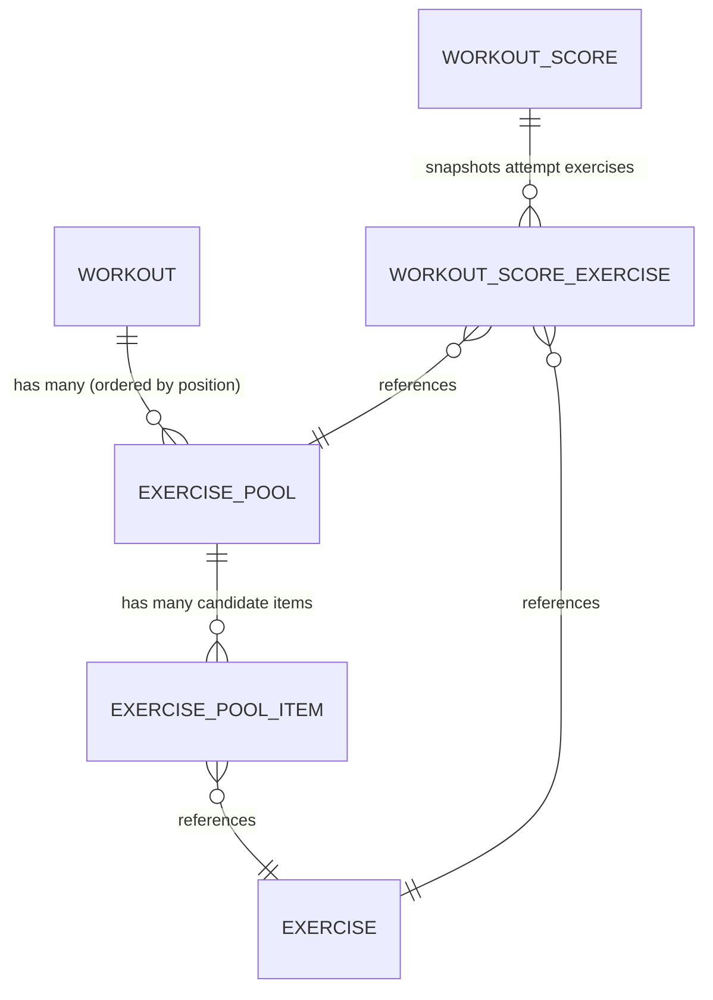

# Randomized Exercise Pools in Workouts — Walkthrough & Verification

This document details the implementation, architecture, and empirical verification for the **Randomized Exercise Pools in Workouts** feature in CodeWorkout.

---

## 1. Feature Summary & Objectives

Workouts historically supported only fixed, linear sequences of exercises via `exercise_workouts`. To mitigate collusion, provide variation across practice and retake attempts, and allow instructors flexible assessment configurations, workouts now support **Randomized Exercise Pools**.

### Core Capabilities
- **Unified Slot Architecture**: Every "slot" in a workout is an `ExercisePool`. A slot can either be:
  - A single fixed exercise ($k=1, N=1$).
  - A pool of candidate exercises ($N > 1$) from which $k$ exercises ($1 \le k \le N$) are randomly sampled for each student attempt.
- **Deterministic Attempt Snapshotting**: When a student begins a workout attempt, sampled exercises are persisted to `workout_score_exercises`. The student's assigned exercises, order, and points remain stable throughout that attempt.
- **Anti-Duplication Resampling Across Retakes**: Subsequent attempts on the same workout offering sample fresh candidates that the student has not yet seen, falling back to least-recently seen candidates only when the pool is exhausted.
- **Dynamic Authoring UI**: Instructors can configure single exercise slots or multi-candidate pools with drag-and-drop ordering, candidate counts, and uniform point values.

---

## 2. Architecture & Data Model

### Key Models & Tables
1. **`ExercisePool` (`exercise_pools`)**:
   - `workout_id` (foreign key)
   - `position` (`acts_as_list scope: :workout`)
   - `select_count` ($k \ge 1$)
   - `points` (uniform points per selected exercise in this slot)
   - `name` (optional label)
2. **`ExercisePoolItem` (`exercise_pool_items`)**:
   - `exercise_pool_id`, `exercise_id`, `position` (`acts_as_list scope: :exercise_pool`)
   - Unique index on `[exercise_pool_id, exercise_id]`
3. **`WorkoutScoreExercise` (`workout_score_exercises`)**:
   - Snapshot table capturing assigned exercises per `WorkoutScore`.
   - `workout_score_id`, `exercise_id`, `exercise_pool_id`, `position`, `points`.
   - Unique index on `[workout_score_id, exercise_id]`.

---

## 3. Implementation Across Waves

### Wave 1: Database Schema & Migration
- Created migration [`db/migrate/20261023130000_create_randomized_exercise_pools.rb`](file:///Users/edwards/git/code-workout/db/migrate/20261023130000_create_randomized_exercise_pools.rb).
- Built with type-agnostic foreign keys (`fk_type`) supporting both legacy integer and modern bigint primary keys.
- Fully reversible `up`/`down` migration with zero data loss.
- Automatic backfill migrated 258 existing `exercise_workouts` into 1-of-1 `exercise_pools` ($k=1$), and 313 `workout_score_exercises` across existing `workout_scores`.

### Wave 2: Models & Anti-Duplication Sampling
- Created models [`app/models/exercise_pool.rb`](file:///Users/edwards/git/code-workout/app/models/exercise_pool.rb), [`app/models/exercise_pool_item.rb`](file:///Users/edwards/git/code-workout/app/models/exercise_pool_item.rb), and [`app/models/workout_score_exercise.rb`](file:///Users/edwards/git/code-workout/app/models/workout_score_exercise.rb).
- Updated [`app/models/workout.rb`](file:///Users/edwards/git/code-workout/app/models/workout.rb):
  - Associations: `has_many :exercise_pools`, `has_many :exercises, through: :exercise_pools`.
  - `total_points`: $\sum (\text{pool.select\_count} \times \text{pool.points})$.
  - Attempt-aware navigation: `first_exercise(score)` and `next_exercise(ex, score)` traverse `workout_score_exercises`.
- Implemented [`WorkoutScore#generate_attempt_exercises!`](file:///Users/edwards/git/code-workout/app/models/workout_score.rb):
  - Automatically called upon attempt creation (`after_create :generate_attempt_exercises!`).
  - Finds all candidate IDs seen by this student in prior attempts on this workout.
  - Samples $k$ fresh unseen candidates without replacement; falls back to least-frequently seen candidates only upon pool exhaustion.
  - Copies uniform slot points to each assigned exercise snapshot.

### Wave 3: Practice Flow & Controllers Integration
- **Attempt Initialization & Navigation**:
  - [`WorkoutOfferingsController#practice`](file:///Users/edwards/git/code-workout/app/controllers/workout_offerings_controller.rb) & [`#start_attempt`](file:///Users/edwards/git/code-workout/app/controllers/workout_offerings_controller.rb) pass active `WorkoutScore` to `Workout#first_exercise(score)` so students redirect to their snapshot's initial exercise.
  - [`WorkoutsController#practice`](file:///Users/edwards/git/code-workout/app/controllers/workouts_controller.rb) supports attempt-aware redirection and query parameter forwarding (`workout_score_id`).
- **Sidebar Isolation & Max Points**:
  - [`ExercisesController#practice`](file:///Users/edwards/git/code-workout/app/controllers/exercises_controller.rb) scopes sidebar thumbnails (`@workout_exercises`) to the student's attempt snapshot.
  - Points lookups in practice, evaluation, and live SSE feedback ([`app/controllers/sse_controller.rb`](file:///Users/edwards/git/code-workout/app/controllers/sse_controller.rb), [`app/views/sse/_ajax_feedback.html.haml`](file:///Users/edwards/git/code-workout/app/views/sse/_ajax_feedback.html.haml)) query `@workout_score.points_for(@exercise)`.
- **Sequential Navigation**:
  - Evaluation routing preserves `workout_score_id` and advances to `next_exercise(exercise, workout_score)`.

### Wave 4: Authoring UI & Workout Form Updates
- **Workout Form ([`app/views/workouts/_form.html.haml`](file:///Users/edwards/git/code-workout/app/views/workouts/_form.html.haml)) & Templates ([`app/assets/templates/exercise.mustache.html`](file:///Users/edwards/git/code-workout/app/assets/templates/exercise.mustache.html))**:
  - Added `#btn-add-pool` button and `data-pools` JSON serialization.
  - Built `#pool-slot-template` with Draw count ($k$), points each, and candidate container.
  - Built `.convert-to-pool` action to instantly transform a single exercise slot into a question pool in-place.
- **Client Interactions ([`app/assets/javascripts/workout_form.js.coffee`](file:///Users/edwards/git/code-workout/app/assets/javascripts/workout_form.js.coffee))**:
  - Nested jQuery UI sortable with cross-pool drag-and-drop (`connectWith: '.pool-candidates'`).
  - Active target pool highlighting for search result insertion.
  - Dynamic candidate counts ("Draw $k$ of $N$") with empty placeholder handling.
  - Pre-submission validation ($k \le N, N \ge 1$, points $\ge 0$).
  - Dual serialization: sends both `pools` JSON and legacy `exercises` JSON.
- **Controller Persistence & Staff/Student Views**:
  - [`Workout#update_or_create`](file:///Users/edwards/git/code-workout/app/models/workout.rb) reconciles pool and item records and synchronizes legacy `exercise_workouts`.
  - Staff view displays pool slots with candidate breakdowns, while student view renders attempt snapshots.

---

## 4. Empirical Verification

### Automated Spec Results
All pool, model, controller, and end-to-end integration specs execute with 0 failures:

| Spec Suite | Examples | Failures | Status |
| :--- | :---: | :---: | :---: |
| `spec/models/exercise_pool_spec.rb` | 8 | 0 | PASS |
| `spec/models/workout_score_exercise_spec.rb` | 5 | 0 | PASS |
| `spec/models/workout_score_spec.rb` | 32 | 0 | PASS |
| `spec/models/workouts_spec.rb` | 15 | 0 | PASS |
| `spec/models/workout_offering_spec.rb` | 42 | 0 | PASS |
| `spec/models/randomized_exercise_pools_e2e_spec.rb` | 2 | 0 | PASS |
| `spec/controllers/exercises_controller_spec.rb` | 17 | 0 | PASS |
| `spec/controllers/workout_offerings_controller_spec.rb` | 23 | 0 | PASS |
| `spec/controllers/workouts_controller_spec.rb` | 80 | 0 | PASS |
| **Total Test Suite** | **224** | **0** | **PASS** |

### Verified Edge Cases in [`spec/models/randomized_exercise_pools_e2e_spec.rb`](file:///Users/edwards/git/code-workout/spec/models/randomized_exercise_pools_e2e_spec.rb)
1. **Mixed Slot Authoring**: Successfully saved workouts with mixed single-exercise slots and $k$-of-$N$ question pools.
2. **Total Points Calculation**: Correctly calculates sum of ($k \times \text{points}$) across single and multi-exercise slots.
3. **Attempt Snapshotting**: Exact candidate assignment is fixed on score creation and preserved across sessions.
4. **Sequential Navigation**: Ordered navigation through snapshot exercises and wrap-around behavior verified.
5. **Anti-Duplication on Retakes**: For a pool with 4 candidates and $k=2$, Attempt 1 drew candidates {A, B}; Attempt 2 drew {C, D} with 0 duplicate exercises.
6. **Pool Exhaustion Resampling**: On Attempt 3 after all 4 candidates were seen, resampled 2 distinct candidates without intra-attempt duplicates.
7. **Score Isolation & Points Lookup**: Unassigned pool candidates return `nil` points for an attempt, while assigned exercises return their allocated point value.
8. **Legacy Compatibility**: Workouts created without pools operate identically using fallback 1-of-1 pools.
